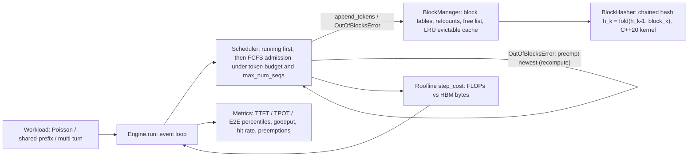

# kvserve: Paged-KV LLM Serving Engine Simulator

[](https://github.com/nagarjunak-pixel/kvserve/actions/workflows/ci.yml)
    

**kvserve is a from-scratch, executable model of how a modern LLM inference engine (vLLM/SGLang-class) turns one GPU into a serving system.** It lets you measure what each mechanism buys before you touch production. Its components are:

- **PagedAttention block manager:** fixed-size KV blocks, per-sequence block tables, and reference-counted sharing.
- **Automatic prefix caching:** content-addressed full blocks via chained hashes, refcount-0 blocks kept cached and evicted LRU, and a native C++20 hash kernel that is bit-exact with its NumPy twin.
- **Iteration-level scheduler:** continuous batching (Orca), a decode-first token budget, chunked prefill (Sarathi-Serve), recompute preemption with LIFO victims and an admission watermark.
- **Static batching baseline**, plus a vLLM-v0-style prefill-priority mode for the no-chunking comparison.
- **GQA-aware roofline step-cost model:** `max(FLOPs / (peak·MFU), bytes / (HBM·MBU)) + overhead`, with weight reads, KV reads and writes, and causal-attention FLOPs.
- **Workloads:** Poisson/ShareGPT-like traffic, multi-tenant shared system prompts, and multi-turn agent sessions whose prompts grow turn by turn.

## Results (Llama-3-8B on one H100, simulated; SLO = TTFT ≤ 2 s and TPOT ≤ 100 ms)

`uv run kvserve bench` reproduces every number below. CI re-runs it, and the raw output is in [`benchmarks/results.json`](benchmarks/results.json).

**1. Continuous vs static batching (Poisson, 400 requests, mean prompt 512 / output 128)**

| offered load | policy | tok/s | goodput (req/s) | TTFT p50 | TTFT p99 | SLO met |
| --- | --- | --- | --- | --- | --- | --- |
| 10 rps | continuous | 1,179 | 9.35 | 0.019 s | 0.085 s | 100% |
| 10 rps | static | 1,039 | 1.11 | 5.18 s | 8.78 s | 13.5% |
| 30 rps | continuous | **2,750** | **21.8** | 0.028 s | **0.119 s** | 100% |
| 30 rps | static | 1,151 | 0.41 | 13.6 s | 29.3 s | 4.5% |
| 50 rps | continuous | 3,431 | 27.2 | 0.063 s | 0.249 s | 100% |
| 50 rps | static | 1,201 | 0.45 | 15.4 s | 28.9 s | 4.8% |

At 30 rps, continuous batching delivers **2.4× the token throughput** and a **246× lower p99 time-to-first-token**. Under static batching, new requests wait for the whole previous batch to drain.

**2. Automatic prefix caching**

| workload | prefix cache | block hit rate | prefill tokens computed | TTFT p50 | TTFT p99 |
| --- | --- | --- | --- | --- | --- |
| shared system prompt (4 × 1,024-token prefixes) | on | **93.8%** | **22,516** | 0.013 s | 0.034 s |
| | off | 0% | 325,620 | 0.040 s | 0.127 s |
| multi-turn agent (5 turns, growing history) | on | **82.0%** | **36,859** | 0.013 s | 0.021 s |
| | off | 0% | 193,179 | 0.024 s | 0.058 s |

Prefix caching skips **93%** of prefill compute on the shared-prompt workload and **81%** on agent sessions. It cuts p99 TTFT by about 3.7× on shared prompts and 2.8× on agent sessions.

**3. Chunked prefill (long prompts: mean 3,000 tokens, 8 rps)**

| configuration | TPOT p99 | TTFT p50 | TTFT p99 | SLO met |
| --- | --- | --- | --- | --- |
| chunked, 512-token budget | **0.017 s** | 0.252 s | 0.987 s | 100% |
| chunked, 2,048-token budget | 0.048 s | 0.218 s | 0.876 s | 100% |
| no chunking (prefill-priority, 8,192 budget) | 0.064 s | 0.201 s | 2.974 s | 91.7% |

Chunking stops long prefills from stalling running decodes, so **p99 TPOT is 3.8× lower**. The trade-off from Sarathi-Serve is also visible: unchunked prefill has a slightly lower median TTFT.

**4. KV memory pressure (Poisson 20 rps, 300 requests; invariants checked after every step)**

| KV blocks (GiB) | preemptions | goodput | TTFT p99 | SLO met |
| --- | --- | --- | --- | --- |
| 400 (0.78) | 25 | 0.86 | 18.0 s | 10.7% |
| 800 (1.56) | 15 | 9.93 | 2.45 s | 71.7% |
| 1,600 (3.13) | 0 | 15.47 | 0.089 s | 100% |
| 8,000 (15.6) | 0 | 15.47 | 0.089 s | 100% |

Every request completes even under heavy preemption. Preempted sequences re-hit their own cached blocks during recompute (7% hit rate at 400 blocks), as in vLLM.

**5. Native kernel:** chained block hashing over 200k tokens (12,500 blocks) takes **0.66 ms in C++20 vs 576 ms in the NumPy reference twin (~870×)**, with bit-exact output.

## Architecture



**Key invariants** (`BlockManager.check_invariants`, asserted after every step in the tests):
- Every physical block is in exactly one state: referenced, cached-evictable, or free.
- Each block's refcount equals the number of block tables pointing at it.
- After a run completes, no blocks leak.
- Generated token streams match the requests exactly, even across preemption and recompute.

## Quick start

```bash
uv sync --python 3.13 --all-extras
uv run kvserve bench                                   # all experiments (~5 s)
uv run kvserve simulate --workload shared-prefix --n 300 --rate 12
uv run kvserve simulate --rate 30 --policy static       # compare against static batching
uv run kvserve serve --port 8099                        # POST /v1/simulate
```

```python
from kvserve import EngineConfig, simulate, shared_prefix_workload, LLAMA3_8B, H100

reqs = shared_prefix_workload(n=300, rate=12)
res = simulate(reqs, EngineConfig(num_blocks=8000, max_batched_tokens=512), LLAMA3_8B, H100,
               check_invariants=True)
print(res.summary())   # throughput, goodput, TTFT/TPOT p50/p99, hit rate, preemptions...
```

## Engineering guarantees

- **Mechanism tests** assert the qualitative claims: continuous ≫ static, prefix caching cuts prefill by >70%, chunking halves p99 TPOT, and memory pressure causes preemptions without losing requests.
- **Unit tests** cover each mechanism: refcounted sharing, LRU eviction of cached blocks, duplicate-content blocks never cached twice, `OutOfBlocksError` leaving state unchanged, invariant-checker corruption detection, and roofline regimes (memory-bound decode, compute-bound prefill).
- **Hash kernel:** C++20 and NumPy produce bit-identical results, checked by Hypothesis property tests together with chain-continuation and prefix semantics.
- **Gates:** ruff, `mypy --strict` on src and tests, pytest with **≥95% branch coverage** (currently 99%+), C++ built with `-Wall -Wextra -Werror` in CI. **No mocks.**

## Scope and honest limits

- This is a **simulator**. Step times come from an analytical roofline model with fixed MFU/MBU, not from measured kernels. Absolute numbers are indicative; the relative comparisons between mechanisms are what the model is for.
- It models a single GPU with no tensor or pipeline parallelism. Preemption is recompute-only (no CPU swap). Speculative decoding and disaggregated prefill/decode are out of scope.

## References

Kwon et al., *PagedAttention / vLLM* (SOSP 2023) · Yu et al., *Orca* (OSDI 2022) · Agrawal et al., *Sarathi-Serve* (OSDI 2024) · Zheng et al., *SGLang / RadixAttention* (2024) · Williams et al., *Roofline* (CACM 2009) · Ainslie et al., *GQA* (2023).

---

## Author & Canonical Portfolio

Engineered by **Nagarjuna Reddy Kamireddy** (*Principal / Lead AI Architect*). Released under the [Apache-2.0 License](LICENSE).
- **Architecture Portfolio & Case Studies:** [https://nagarjunak-pixel.github.io/](https://nagarjunak-pixel.github.io/)
- **GitHub:** [@nagarjunak-pixel](https://github.com/nagarjunak-pixel) · **LinkedIn:** [in/nagarjuna-kamireddy](https://linkedin.com/in/nagarjuna-kamireddy)
